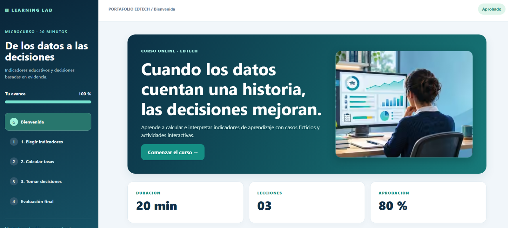
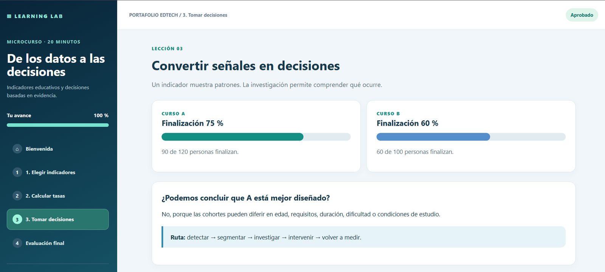
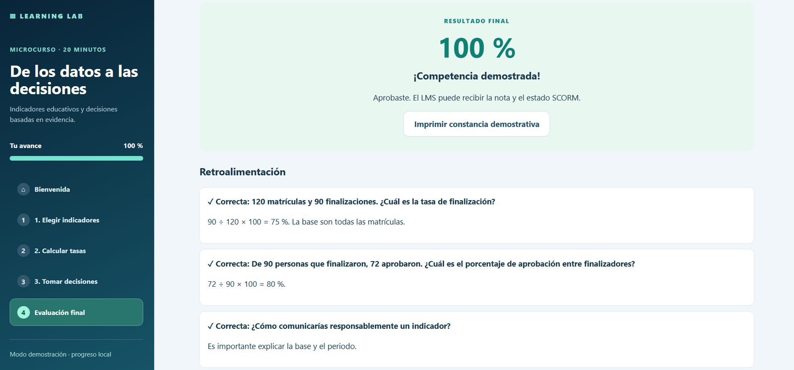

# De los datos a las decisiones 🎓

**Curso interactivo sobre indicadores de aprendizaje**

**EdTech · Diseño instruccional · HTML5 · CSS · JavaScript · SCORM 1.2**

Proyecto de portafolio de Merbyn Gómez Rondón: un minicurso en español con **tres lecciones**, tres comprobaciones de aprendizaje, ejemplos numéricos y una **evaluación final de cinco preguntas**. Está diseñado como demostración de desarrollo de contenidos digitales para educación corporativa.

## Galería del curso · Capturas reales

Las siguientes imágenes proceden de la **demostración del curso ejecutada en navegador**. Muestran el diseño, una actividad de interpretación y el resultado de una evaluación completada. El 100 % corresponde a una prueba del propio curso, **no a una certificación externa ni a una prueba de interoperabilidad en un LMS real**.

### 1. Bienvenida: experiencia de aprendizaje

[](https://merbyn-gomez.github.io/interactive-scorm-course/)

### 2. Desarrollo: interpretar indicadores y tomar decisiones



### 3. Evaluación: calificación y retroalimentación



**[▶ Probar el curso online](https://merbyn-gomez.github.io/interactive-scorm-course/)** · **[Ver el código](index.html)** · **[Descargar paquete SCORM probado estructuralmente](https://github.com/merbyn-gomez/interactive-scorm-course/actions)**

### Bienvenida visual

La portada del curso combina una introducción y una ilustración de una profesional que analiza indicadores en un LMS. La imagen se guarda en `assets/lms-analytics-welcome.avif` y **se incluye en el paquete SCORM** para que no dependa de una conexión externa. Se utiliza formato AVIF optimizado; requiere un navegador moderno compatible con AVIF.


### Probar el curso
- **Demostración online:** [Abrir el curso en GitHub Pages](https://merbyn-gomez.github.io/interactive-scorm-course/) (probada por el autor en noviembre de 2026).
- **Vista local:** descarga el repositorio y abre `index.html` en un navegador actualizado.

### Objetivos de aprendizaje
1. Distinguir finalización, aprobación y actividad educativa.
2. Calcular tasas con numeradores y denominadores definidos.
3. Interpretar señales ficticias de un LMS y proponer acciones basadas en evidencia.

### Secuencia didáctica
| Sección | Experiencia |
| --- | --- |
| Inicio | Objetivos, duración aproximada de 20 minutos |
| Lección 1 | Elegir indicadores adecuados |
| Lección 2 | Calcular tasas: 120 matrículas, 90 finalizadores y 72 aprobados |
| Lección 3 | Interpretar datos y evitar conclusiones causales apresuradas |
| Evaluación final | Cinco preguntas, cuatro correctas para aprobar (**80 %**) |

### Integración SCORM 1.2
El curso está implementado como un único SCO. Intenta conectarse con la API SCORM 1.2 del LMS y almacenar avance, sección, puntuación (0–100) y estado de aprobación. Si no hay plataforma, utiliza `localStorage` en el navegador.

**Importante:** se ha comprobado la sintaxis JavaScript y la estructura XML/ZIP mediante GitHub Actions, pero la comunicación completa todavía debe validarse en un Moodle, Blackboard u otro LMS compatible.

### Descargar el paquete SCORM
Abre [Actions](https://github.com/merbyn-gomez/interactive-scorm-course/actions) → ejecución exitosa **Validate & build SCORM package** → sección **Artifacts** → descarga `scorm-12-package`. El archivo descargado contiene `curso-indicadores-SCORM12.zip`. El manifiesto se encuentra en la raíz del ZIP interior, que es el archivo que debes importar al LMS.

También puedes generar el ZIP en tu equipo desde la raíz del repositorio:

```powershell
python -c "from pathlib import Path; from zipfile import ZipFile, ZIP_DEFLATED; z=ZipFile('curso-indicadores-SCORM12.zip','w',ZIP_DEFLATED); [z.write(str(p),str(p).replace('\\','/')) for p in [Path('index.html'),Path('imsmanifest.xml'),Path('assets/lms-analytics-welcome.avif')]]; z.close()"
```

### Estructura
```text
index.html                  # Curso y runtime SCORM en una sola página
assets/lms-analytics-welcome.avif   # Ilustración de bienvenida
imsmanifest.xml             # Manifiesto SCORM 1.2
tests/validate.py           # Validación de sintaxis y paquete
.github/workflows/          # Construcción automática del ZIP
README.md                   # Documentación del portafolio
```

**Datos y transparencia:** todos los casos son ficticios. No hay datos privados de estudiantes ni empresas. No se expide certificación académica oficial.

---

**English:** Interactive Spanish microcourse on learning analytics KPIs, built with vanilla JavaScript and a SCORM 1.2 interface. Features structured lessons, formative feedback, five-question final assessment and local progress persistence. LMS-specific interoperability awaits validation.
